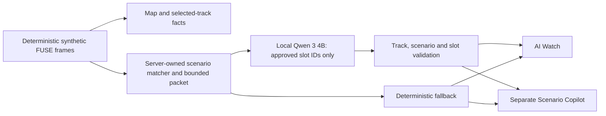

# Later synthetic-console architecture

The application source is private. This describes the boundaries visible in the recorded demonstration, not setup instructions or a source release.

The browser requests a timestep and selected fused-track ID, plus an optional approved question ID. It never sends free-form prompts, map tiles, exact coordinates, raw media or field evidence to the local analyst. The analyst loads FUSE facts itself. It uses Qwen 3 4B by default; Llama 3.1 8B is a manual evaluation option, with no automatic fallback between models.

The model chooses and orders catalog-approved explanation slots. The server validates them before display. The console substitutes current fetched-frame values into those same approved templates as playback advances, so a cached slot choice cannot freeze an old uncertainty value. Watch and Copilot share the explanation contract and selected-track/scenario identity. Stale responses are discarded. Pending Watch/Copilot requests are serialized and superseded queued work is discarded.

The main dashboard has no chat input. A separate Copilot offers only catalog-approved question buttons. It explains the evidence boundary; it does not decide the review question or recommend an operational action. A schema-valid response demonstrates contract compliance, not verified judgment, calibrated probability or field performance.

The map uses a grayscale OpenStreetMap reference around Munich. It does not locate a field test, real sensor installation or deployment. Track/sensor/RF overlays and their displayed GCS-relative geometry are synthetic.

The separate SENSE service serves retained evidence records; it is not running the detector checkpoint on incoming camera frames. The Python REASON service remains deterministic. The optional local analyst is a separate loopback-only service, not evidence of a continuous camera → detector → fusion → model system.
